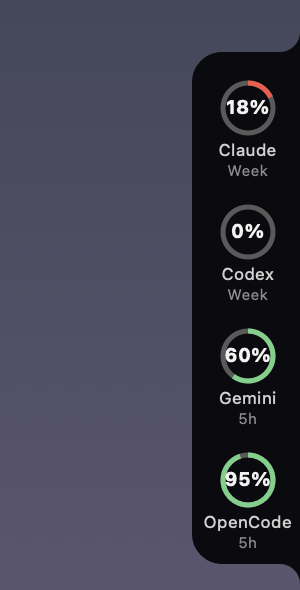

# AI Usage Notch（AI の残り量サイドノッチ）

**Claude・Codex・Gemini・OpenCode の「あとどれだけ使えるか」を、Mac の画面の端の小さな黒い出っぱりで見られます。**

[English](README.md)

<p align="center"> &nbsp; </p>

- **じゃまにならない。** メニューバーにも窓にも出ません。画面の端の細い線に、マウスが触れたときだけ開きます。
- **電池と同じ「残り%」。** 緑はたっぷり、オレンジは少なめ、赤はもうすぐ切れます。
- **契約している AI をまとめて。** Claude（5時間と週の枠）、Codex（週の枠と追加クレジット）、Gemini（Antigravity）、OpenCode Go。
- **使っているものだけ出る。** Mac に入っていない AI の丸は自動で隠れます。
- **小さくて中身が読める。** [Hammerspoon](https://www.hammerspoon.org/) の上で動く、約1,800行の Lua と Python です。アカウントも、利用状況の送信もありません。

## 入れ方（1分）

macOS と [Hammerspoon](https://www.hammerspoon.org/)（無料）が要ります。

```bash
brew install --cask hammerspoon   # 入っていれば不要
git clone https://github.com/nick353/ai-usage-notch.git ~/ai-usage-notch && ~/ai-usage-notch/install.sh
```

Hammerspoon を一度開き、聞かれたら「アクセシビリティ」を許可します。画面の右端の、真ん中より少し下にマウスを寄せてください。

Claude の枠を初めて読むとき、macOS が「security がキーチェーンの "Claude Code-credentials" を読もうとしています」と聞くことがあります。「常に許可」を押してください（下の「プライバシー」）。

## 使い方

| すること | どうなるか |
|---|---|
| 画面の端に触れる | 出っぱりが開く |
| 丸に乗せる | 戻る時刻・使った量・残りのクレジットが出る |
| 丸を押す | 時間の幅を切り替え（5時間 → 週 → 月、など） |
| `option` を押しながら押す | 今すぐ新しくする |
| 長押し・引っぱる | 好きな所へ運べる。近い端に吸いつき、場所を覚える |
| `ctrl` + `option` + `cmd` + `U` | 5秒だけ開く |
| 一番下の **•••** を押す・右クリック | 表示するものを選ぶ: AI や時間の幅の出す・出さない、並べ替え、自分の項目を足す |

## 自分好みにする

出っぱりの一番下の **•••** を押します（右クリックでも開きます）。

- AI ごとに **出す・出さない** を選べます。この Mac に見つからない AI も一覧に出るので、あえて出すこともできます。
- 丸を押したときに切り替わる **時間の幅** を選べます（例: Claude は「週間」だけ）。
- **上へ・下へ** で並び順を変えられます。
- **自分の項目を足す…** で、好きな数字を丸にできます。名前と、数字を出すコマンドを入れます。

コマンドが出すもの:

| 出す文字 | 丸の見え方 |
|---|---|
| `42` | 残り42%の丸 |
| `{"percent": 15, "sub": "日", "tip2": "なんでも"}` | 自分の見出しと説明つきの丸 |
| `[{"percent": 80, "sub": "月"}, {"center": "3", "sub": "やること"}]` | いくつかの表示。丸を押すと切り替わる |

足した項目は `config.json` の `"custom"` に入るので、そこで直すこともできます。

```json
"custom": [
  {"label": "Demo", "command": "echo 42"},
  {"label": "OpenRouter", "command": "curl -s https://openrouter.ai/api/v1/credits -H \"Authorization: Bearer $OPENROUTER_API_KEY\" | python3 -c 'import json,sys; d=json.load(sys.stdin)[\"data\"]; print(round(100*(1-d[\"total_usage\"]/d[\"total_credits\"])))'", "timeout": 10}
]
```

コマンドはログインしたときと同じシェル（`bash -l`）で動くので、`PATH` や環境変数がそのまま使えます。消すときは、その項目の中のメニューの **この項目を消す**。**表示を最初に戻す** で最初の形に戻ります。

## 数字の出どころ

| AI | 出どころ | 見えるもの |
|---|---|---|
| Claude | Claude Code のログインを使って Anthropic の使用量の窓口に聞く（5分に1回まで）。使った量は `~/.claude/projects/` | 5時間・週の枠の残り、5時間・24時間の使用量 |
| Codex | `~/.codex/sessions/` の最新の `rate_limits` | 週の枠の残り、追加クレジット、使用量 |
| Gemini | `~/.gemini/antigravity-cli/` の記録 | `config.json` の目安に対する残り（推定） |
| OpenCode Go | `~/.local/share/opencode/opencode.db` | `config.json` の目安に対する使った額 |

Gemini と OpenCode は「残り%」を公開していないので、推定です。`config.json` の目安を自分のプランに合わせてください。

## 設定

`config.example.json` を `config.json` に写して直します（入れるときに自動で写します）。

| 名前 | 既定 | 意味 |
|---|---|---|
| `lang` | Mac の言語 | `"ja"` か `"en"` |
| `hide` | `[]` | 隠す AI。例 `["gemini"]` |
| `claude_oauth` | `true` | `false` にすると Claude Code のログインを読まない（使った量だけ出る） |
| `claude_oauth_interval_sec` | `300` | Claude の枠を聞く間隔（秒） |
| `refresh_sec` | `120` | ほかの数字を新しくする間隔（秒） |
| `gemini_plan` | `"auto"` | Gemini のプラン基準（`"auto"`・`"free"`・`"plus"`・`"pro"`・`"ultra_5x"`・`"ultra_20x"`）。`auto` は使えるモデルと消費実測から自動判定。**•••** メニューからも切替可能 |
| `gemini_*_usd`・`opencode_*_usd` | 任意 | 推定の残り%に使う目安を手動で上書きしたい場合のみ |

`./doctor.sh` で設定を点検できます。

## プライバシー

- 1つの問い合わせ以外は、すべてこの Mac の中で、上の表のファイルを読むだけです。
- その1つ: Claude の公式の5時間・週の枠を出すため、Claude Code がキーチェーンに保存したログイン情報（または `CLAUDE_CODE_OAUTH_TOKEN`）を読み、**`api.anthropic.com` にだけ**送ります。Claude Code 自身が送る先と同じです。保存・記録・表示はしません。[CodexBar](https://github.com/steipete/CodexBar) など、ほかの使用量の道具と同じやり方です。`"claude_oauth": false` で止められます。
- この窓口は Anthropic が正式に公開したものではなく、変わることがあります。失敗したときは、使った量の表示だけに静かに切り替わります。

## 外し方

```bash
~/ai-usage-notch/uninstall.sh
```

`~/.hammerspoon/init.lua` から、自分の分だけを消します。

## 関連

- [Work Recorder](https://github.com/nick353/work-recorder) — 同じ形の出っぱりで、画面と声を録画して AI に作業を覚えさせる道具。

## ライセンス

MIT
