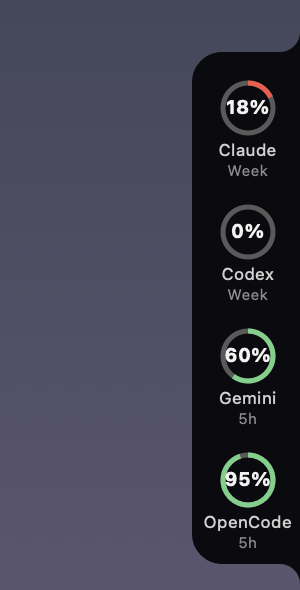

# AI Usage Notch

**See how much of your Claude, Codex, Gemini and OpenCode limits you have left — from a tiny black notch on the edge of your Mac screen.**

[日本語](README.ja.md)

<p align="center"> &nbsp; </p>

- **Out of the way.** No menu-bar icon, no window. A 6-pixel line sits on the screen edge and opens only when your mouse touches it.
- **Remaining %, like a battery.** Green = plenty, orange = getting low, red = almost out.
- **Every AI you pay for, in one place.** Claude (5-hour and weekly limits), Codex (weekly limit and extra credits), Gemini/Antigravity and OpenCode Go.
- **Only shows what you use.** AIs that are not installed on your Mac are hidden automatically.
- **Small and readable.** About 1,400 lines of Lua + Python on top of [Hammerspoon](https://www.hammerspoon.org/). No app to trust, no account, no telemetry.

## Install (1 minute)

You need macOS and [Hammerspoon](https://www.hammerspoon.org/) (free).

```bash
brew install --cask hammerspoon   # skip if you already have it
git clone https://github.com/nick353/ai-usage-notch.git ~/ai-usage-notch && ~/ai-usage-notch/install.sh
```

Open Hammerspoon once and allow **Accessibility** when macOS asks. Then move your mouse to the right edge of the screen, slightly below the middle.

The first time Claude limits are read, macOS may ask whether `security` can read the **"Claude Code-credentials"** keychain item. Click **Always Allow** (see [Privacy](#privacy)).

## How to use

| Do this | What happens |
|---|---|
| Touch the screen edge | The notch opens |
| Hover a ring | Details: when the limit resets, tokens used, credits left |
| Click a ring | Switch the time window (5h → week → month, or limit → tokens) |
| `option` + click | Refresh now |
| Long-press or drag | Move the notch anywhere; it snaps to the nearest edge and remembers the spot |
| `ctrl` + `option` + `cmd` + `U` | Peek for 5 seconds |

## Where the numbers come from

| AI | Source | What you see |
|---|---|---|
| Claude | Anthropic's usage endpoint, using your existing Claude Code login (every 5 min at most). Token counts from `~/.claude/projects/` | 5-hour and weekly limit left, tokens in the last 5h / 24h |
| Codex | The latest `rate_limits` in `~/.codex/sessions/` | Weekly limit left, extra credits, tokens |
| Gemini | Antigravity transcripts in `~/.gemini/antigravity-cli/` | Estimated % left against the caps in `config.json` |
| OpenCode Go | `~/.local/share/opencode/opencode.db` | Spend vs. the caps in `config.json` |

Gemini and OpenCode do not publish a remaining-% number, so those are estimates. Adjust the caps in `config.json` to match your plan.

## Settings

Copy `config.example.json` to `config.json` (the installer does this for you) and edit:

| Key | Default | Meaning |
|---|---|---|
| `lang` | your macOS language | `"en"` or `"ja"` |
| `hide` | `[]` | AIs to hide, e.g. `["gemini"]` |
| `claude_oauth` | `true` | Set `false` to never read the Claude Code login (you will still see token counts) |
| `claude_oauth_interval_sec` | `300` | How often to ask Anthropic for Claude limits |
| `refresh_sec` | `120` | How often to refresh everything else |
| `gemini_*_usd`, `opencode_*_usd` | see file | Caps used for the estimated % |

Run `./doctor.sh` to check your setup.

## Privacy

- Everything except one request runs **locally** and only reads the files listed above.
- That one request: to show Claude's official 5-hour/weekly limits, the notch reads the token Claude Code already stored in your keychain (or `CLAUDE_CODE_OAUTH_TOKEN`) and sends it **only to `api.anthropic.com`** — the same place Claude Code sends it. The token is never written to disk, logged or shown. Other usage monitors such as [CodexBar](https://github.com/steipete/CodexBar) use the same approach. Turn it off with `"claude_oauth": false`.
- The endpoint is not officially documented by Anthropic and may change. If it fails, the notch quietly falls back to token counts.

## Uninstall

```bash
~/ai-usage-notch/uninstall.sh
```

It removes only its own block from `~/.hammerspoon/init.lua`.

## Related

- [Work Recorder](https://github.com/nick353/work-recorder) — a matching edge notch that records your screen and voice so an AI can learn the task.

## License

MIT
